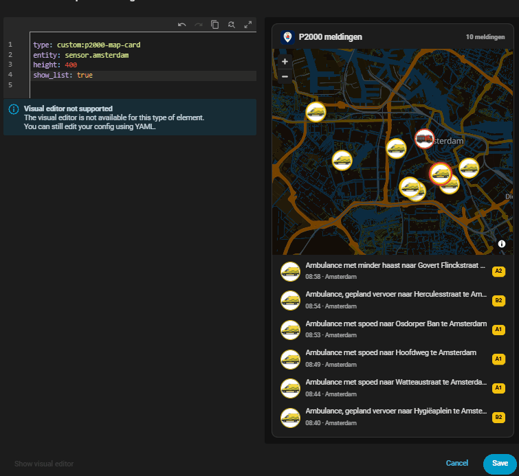
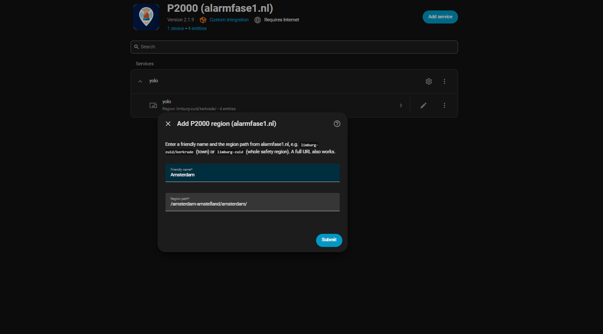

<div align="center">
  
# P2000 Alarmfase1 Integration for Home Assistant

<p align="center">
  <!-- Release / License -->
  <a href="https://github.com/DonTranQuiL/ha-p2000/releases">
    
  </a>
  <a href="https://github.com/DonTranQuiL/ha-p2000/blob/main/LICENSE">
    
  </a>

  <!-- CI / Quality -->
  <a href="https://github.com/DonTranQuiL/ha-p2000/actions">
    
  </a>
  <a href="https://github.com/DonTranQuiL/ha-p2000/actions">
    
  </a>
  <a href="https://github.com/DonTranQuiL/ha-p2000/actions">
    
  </a>

  <!-- Code Quality -->
  <a href="https://github.com/pre-commit/pre-commit">
    
  </a>
  <a href="https://github.com/astral-sh/ruff">
    
  </a>
  </a>
  <a href="https://codecov.io/gh/DonTranQuiL/ha-p2000">
  
  </a>

  <!-- Ecosystem -->
  <a href="https://hacs.xyz/">
    
  </a>
  <a href="https://www.home-assistant.io/">
    
  </a>

  <!-- Social / Support -->
  <a href="https://github.com/DonTranQuiL">
    
  </a>
  <a href="https://ko-fi.com/DonTranQuiL">
    
  </a>
  <a href="https://liberapay.com/Malosaaa/donate">
    
  </a>
  <a href="https://liberapay.com/Malosaaa/donate">
    
  </a>
  <a href="https://liberapay.com/Malosaaa/donate">
    
  </a>
  <a href="https://community.home-assistant.io/">
    
  </a>
  <a href="https://discord.gg/qaHPTTKHae">
    
  </a>
</p>


This custom integration for Home Assistant allows you to scrape emergency messages from [alarmfase1.nl](https://www.alarmfase1.nl/) for a specific region and display them as sensors. It supports filtering by service type and provides geographical coordinates for map integration.
<br>
</div>

## Features
* ✅ **L1-Style Persistence**: Includes a built-in cache system.
* ✅ **Blaxing fast startup and entity control**: Assistant reboots—no more "Unknown" states on startup.
* ✅ **Latest live data**: Fetches the latest P2000 emergency messages from alarmfase1.nl.
* ✅ **Multiple regions**: Add extra regions/towns to one instance via ⚙️ Configure (merged & de-duplicated), or add the integration multiple times.
* ✅ **Bundled P2000 Map Card**: Animated map on HA's built-in map with photo markers for ambulance, fire, police and trauma heli — auto-registered, no manual resource needed.
* ✅ **Recent calls list**: `calls` attribute with the latest messages (incl. coordinates, priority, link) plus a `Meldingen` count sensor.
* ✅ **Filter**: Filter messages by service type (Ambulance, Fire Department, Police, Other) via the Options flow.
* ✅ **Coordinates**: Includes coordinates (latitude and longitude) for displaying incidents on a map.
* ✅ **Diagnostics**: Provides diagnostic sensors for monitoring the integration's status.
* ✅ **Service Calls**: Includes services to manually trigger a refresh or clear the local cache via Developer Tools.
* ✅ **Cool animated card**: Very cool animated dashboard card that matches the emergency.

## 🛠 Services

| Service | Description |
| :--- | :--- |
| `p2000_alarmfase1.manual_refresh` | Forces an immediate scrape of all regions. |
| `p2000_alarmfase1.clear_cache` | Deletes the local `.storage` cache file. |
| `p2000_alarmfase1.clear_debug_file` | Deletes the legacy debug file (no longer written). |

## Prerequisites

* Home Assistant instance.
* [HACS (Home Assistant Community Store)](https://hacs.xyz/) installed.

## Installation (Using HACS)

This integration is best installed via HACS. If you have HACS installed, you can add this repository as a **Custom Repository**.

1.  **Navigate to HACS:** Open Home Assistant and go to HACS in the sidebar.
2.  **Go to Integrations:** Click on "Integrations".
3.  **Add Custom Repository:** Click the three vertical dots (⋮) in the top-right corner and select "Custom repositories".
4.  **Enter Repository Details:**
    * In the "Repository" field, paste the URL of this GitHub repository:
      ```
      https://github.com/malosaaa/ha-p2000
      ```
    * In the "Category" dropdown, select **"Integration"**.
    * Click the "Add" button.
5.  **Install Integration:**
    * Close the "Custom repositories" dialog.
    * The "P2000 Alarmfase1" integration should now appear in your HACS Integrations list. Find it or search for it.
    * Click on the integration card.
    * Click the "Download" button (usually in the bottom right).
    * Confirm the download (select the version - usually the latest is recommended).
6.  **Restart Home Assistant:** After HACS finishes downloading, **you MUST restart Home Assistant** for the integration to be loaded. A prompt should appear, or you can do it manually via Developer Tools -> Server Management -> Restart.

## Configuration

Once installed via HACS and after restarting Home Assistant, you can add your desired region:

1.  **Navigate to Integrations:** Go to **Settings -> Devices & Services -> Integrations**.
2.  **Add Integration:** Click the "+ Add Integration" button (usually in the bottom right).
3.  **Search:** Search for "P2000 Alarmfase1" and click on it.
4.  **Enter Region Path:** You will be prompted to enter the **Region Path** for your area. You can find this on the [alarmfase1.nl](https://www.alarmfase1.nl/) website (e.g., `limburg-zuid/maastricht/`).
5.  **Enter Instance Name:** You will also be asked to provide an **Instance Name** (e.g., `maastricht`). This name will be used in the entity IDs (e.g., `sensor.p2000_maastricht`). Click Submit.
6.  **Done!** The integration will be set up for that region, and sensor entities will be created.
7.  **Add More Regions:** To monitor another region, simply repeat steps 2-6.

**Reconfiguring Options:**

You can change the scan interval, enabled sensors, and filters after setup:

1.  Go to **Settings -> Devices & Services -> Integrations**.
2.  Find the "P2000 Alarmfase1" integration entry corresponding to the instance name you want to change.
3.  Click the "CONFIGURE" button on that entry.
4.  Adjust the options as needed and click Submit. Home Assistant will reload the integration with the new settings.

## Available Entities

This integration creates the following entities for each configured region (instance):

* **`sensor.p2000_<instance_name>`**: This sensor provides the priority code of the latest matching emergency message. Its attributes contain detailed information:
    * `priority_code`
    * `date` (of the message)
    * `time` (of the message)
    * `region`
    * `location`
    * `street`
    * `description` (full message text)
    * `latitude`
    * `longitude`
    * `service_type` (e.g., Ambulance, Fire Department, Police)
    * `matches_filter` (indicates if the latest scrape matches the configured filters)
    * `last_update_attempt` (timestamp of the last update attempt)
    * ... (other scraped data based on your options)

* **Diagnostic Sensors:**
    * `sensor.p2000_alarmfase1_<instance_name>_last_update`: Shows "OK" or "Error" for the last update.
    * `sensor.p2000_alarmfase1_<instance_name>_status`: Timestamp of the last successful data fetch

*(Replace `<instance_name>` with the name you provided during configuration, e.g., `maastricht`)*

## Map Integration

The main sensor provides `latitude` and `longitude` attributes, allowing you to display emergency incidents on a Home Assistant map card. The icon of the map marker will dynamically change based on the `service_type` of the message (e.g., ambulance icon, fire truck icon, police car icon).

## 🗺️ P2000 Map Card (bundled)

<p align="center"></p>

The integration ships its own animated map card and **registers it automatically** — no manual dashboard resource, no copying JS to `www/`, no `?v=` resource URL. Just install via HACS, restart Home Assistant and add `type: custom:p2000-map-card` to a dashboard.

> If you previously added a manual resource for `p2000-map-card.js` (Settings → Dashboards → Resources), remove it. Hard-refresh your browser (Ctrl+F5) after every update. It runs on Home Assistant's **built-in map** (`ha-map`, same tiles as the HA map) — no API key, no CDN, no extra resource.

```yaml
type: custom:p2000-map-card
entity: sensor.p2000_kerkrade      # or entities: [sensor.p2000_a, sensor.p2000_b]
title: P2000 meldingen             # optional
height: 400                        # map height in px (default 400)
zoom: 11                           # initial zoom (default 11), map auto-fits to markers
show_list: true                    # list of latest calls under the map (default true)
list_size: 6                       # items in the list (default 6)
max_markers: 50                    # max markers on the map (default 50)
fade_minutes: 60                   # markers older than this get a calmer look (default 60)
dark: auto                         # auto | true | false
```

* Every marker shows a photo of the service (ambulance, brandweer, politie, traumaheli).
* The newest call drops in with a flashing siren ring; older calls keep a softer, slower ping.
* Click a marker or list item for details and a link to alarmfase1.nl.
* The card shows the persistent history (last 10 calls by default) stored by the integration, so calls survive restarts.

**Locations / geocoding:** a call is placed using its latitude/longitude; if missing, the street address is geocoded; if that is missing, the postal code. Calls with none of these are left off the map (they still appear in the sensor). Geocoding uses OpenStreetMap Nominatim server-side, rate limited (1 req/s) and cached persistently.

## Options

Open **Settings → Devices & Services → P2000 Alarmfase1 → ⚙️ (Configure)**:

<p align="center"></p>

* **Extra regions:** Additional region paths (e.g. `brabant-noord/gemert`, `drenthe` or a full alarmfase1.nl URL). Each one is validated before saving. Extra regions are **merged into the same sensor** (one combined feed); add a new integration entry if you want a separate sensor.
* **Scan Interval:** How often to check for new messages (in seconds, min 30).
* **Max calls:** How many recent calls the sensor exposes in its `calls` attribute (default 25).
* **Max age:** Maximum age in minutes of calls fetched per update (default 1440, `0` = no limit). It does not trim the stored history.
* **History size:** Number of calls kept persistently across restarts for the map card (1–50, default 10).
* **Enabled Sensors:** Select which details from the scraped message are included as attributes.
* **Filters:** Enable or disable filtering for specific service types (Ambulance, Fire Department, Police, Other).

**Sensor naming:** each entry creates `sensor.p2000_<name>` (e.g. `sensor.p2000_amsterdam`). Existing entities keep their current entity ID; rename it under the entity settings or re-add the entry to get the new name.

## Troubleshooting

* **Integration not found in HACS:** Ensure you have added your repository as a custom repository in HACS settings and restarted Home Assistant after installation.
* **"Config flow could not be loaded":** Double-check the installation steps and restart Home Assistant. Review your Home Assistant logs for detailed error messages.
* **No entities created after configuration:** Check your Home Assistant logs for any errors related to the `p2000_alarmfase1` integration. Ensure the region path you entered is correct.
* **Sensor shows "Unavailable":** This might happen briefly after a restart. If it persists, check the diagnostic sensors and your Home Assistant logs for any update errors.
* **Map icons not showing:** Ensure the main sensor has valid `latitude` and `longitude` attributes and that the `service_type` is being correctly identified in the attributes.

If you encounter issues, please check the existing issues on GitHub first, and if your problem isn't listed, feel free to open a new issue here:
[https://github.com/malosaaa/ha-p2000/issues](https://github.com/malosaaa/ha-p2000/issues) 

## Contributing

Contributions are welcome! Please feel free to submit issues or pull requests to your GitHub repository.

## License

This project is licensed under the [Apache License 2.0](LICENSE).  

## Disclaimer

* This integration scrapes data from [alarmfase1.nl](https://www.alarmfase1.nl/). The developer of this integration is **not responsible** for the scraping process or any changes to the website that may break the integration.
* Users of this integration are solely responsible for their use and must **respect the terms of service of the alarmfase1.nl website.
* It is highly recommended to use a **reasonable and high scan interval** to avoid overloading the alarmfase1.nl website with excessive requests. You are responsible for configuring the scan interval appropriately.
* This integration is provided **"as is" for educational and personal use only**. The developer assumes no responsibility for any damages or issues arising from the use or misuse of this integration.
* This integration is not affiliated with or endorsed by alarmfase1.nl.

---

---
[hacs]: https://hacs.xyz
[hacs_badge]: https://img.shields.io/badge/HACS-Custom-41BDF5.svg?style=for-the-badge
[maintenance_badge]: https://img.shields.io/badge/Maintained%3F-yes-green.svg?style=for-the-badge
